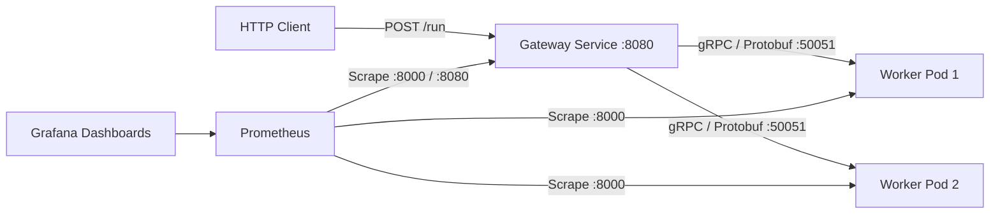

# Cloud-Native SRE & gRPC Microservices Platform

An end-to-end Infrastructure-as-Code (IaC) and Kubernetes microservices platform built with **Terraform, Docker, Containerd, Kubernetes, Helm, Python (FastAPI + gRPC), Prometheus, Grafana, and GitHub Actions**.

## Architecture

## Live Observability Proof
Prometheus scraping custom gRPC counters (`grpc_jobs_processed_total`) load-balanced across multi-node worker pods:

## Repository Structure
* `terraform/` — Oracle Cloud Infrastructure (OCI) VCN, subnets, security lists, and compute IaC
* `k8s/` — Multi-node Kubernetes cluster configuration
* `apps/` — Python FastAPI HTTP-to-gRPC gateway and gRPC Protobuf worker with Prometheus instrumentation
* `helm/` — Parameterized Helm chart (`Deployments`, `Services`, `ServiceMonitor`)
* `.github/workflows/` — Automated CI pipeline for Terraform validation, Helm linting, and Docker builds
